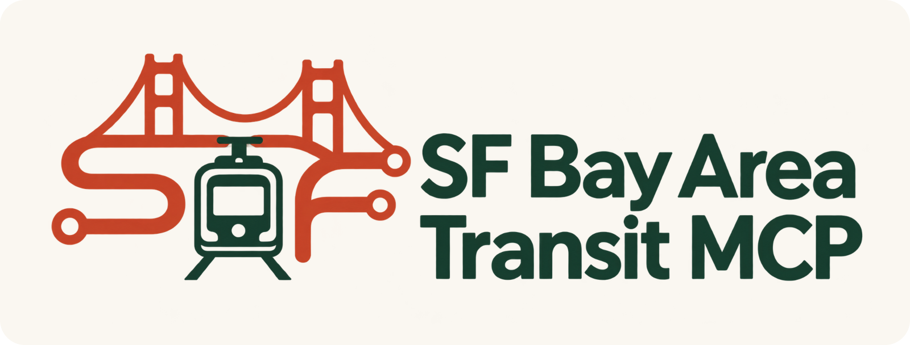
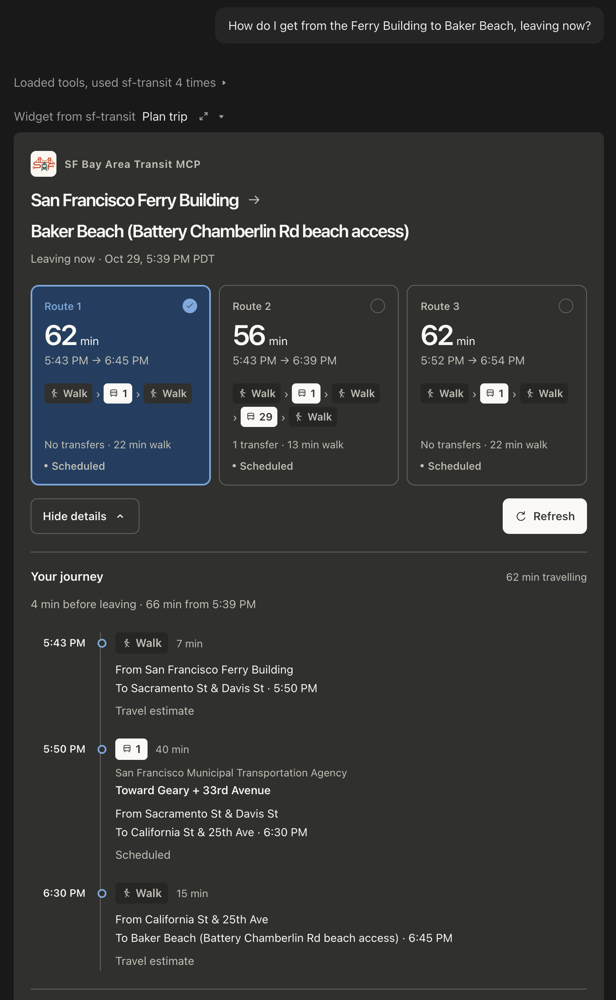

<p></p>

# SF Bay Area Transit MCP

Ask Claude how to get around San Francisco and the Bay Area. Get complete journeys: walking to the stop, which buses or trains to take, transfers, departure and arrival times, and how long the trip takes.

**Free to use. No API keys or authentication.** Runs locally with Claude Desktop or Claude Code, or as a remote MCP on Cloudflare Workers Free. [Transitous](https://transitous.org/) supplies the routing and place search; you do not need to host a routing engine or download feeds.

> “How do I get from home to Baker Beach, leaving now?”
>
> “I need to reach the Ferry Building by 9 tomorrow morning.”
>
> “Compare transit with cycling, and avoid more than one transfer.”

The default provider is for **light, noncommercial, open-source use**. Its service is community-run and has no uptime guarantee. See [provider details](docs/providers.md).

## Get started

Requires Node.js 22.12 or newer and Git.

Add this to your Claude Desktop MCP configuration. It installs the source package from this public repository and starts the server:

```json
{
  "mcpServers": {
    "sf-transit": {
      "command": "npx",
      "args": [
        "--yes",
        "--package=git+https://github.com/czekaj/sf-transit-mcp.git",
        "sf-transit-mcp"
      ]
    }
  }
}
```

Restart Claude Desktop and ask for a trip. For Claude Code:

```sh
claude mcp add sf-transit -- npx --yes --package=git+https://github.com/czekaj/sf-transit-mcp.git sf-transit-mcp
```

### Run from a local checkout

```sh
git clone https://github.com/czekaj/sf-transit-mcp.git
```

From the project directory:

```sh
npm ci --ignore-scripts
npm run build
```

Use your checkout's absolute path in Claude Desktop:

```json
{
  "mcpServers": {
    "sf-transit": {
      "command": "node",
      "args": ["/absolute/path/to/sf-transit-mcp/dist/stdio.js"]
    }
  }
}
```

Restart Claude Desktop. For Claude Code, register the same local server:

```sh
claude mcp add sf-transit -- node /absolute/path/to/sf-transit-mcp/dist/stdio.js
```

The server starts without credentials or environment variables. Tell Claude your starting address, or use an address already in your conversation. The MCP does not save a home profile. Claude resolves places, asks you to choose when needed, then requests the journey.

**Privacy:** place searches and journey coordinates go to Transitous. Its [privacy policy](https://transitous.org/privacy/) says request URLs are logged for up to two days. The MCP does not log or persist addresses or trip results.

## What it does

| Tool               | Purpose                                                                                           |
| ------------------ | ------------------------------------------------------------------------------------------------- |
| `search_places`    | Find Bay Area addresses, landmarks, and stops; return candidate coordinates.                      |
| `plan_trip`        | Find complete journeys, leaving now, departing after a time, or arriving by a deadline.           |
| `get_service_info` | Read the current time, coverage source, attribution, and limitations without an upstream request. |

Transit journeys include walking to and from stops. Options include maximum transfers, a wheelchair profile, and direct walking or personal-bicycle comparisons. Each result provides both readable instructions and structured data.

**MCP compatibility:** supports the published `2026-07-28` protocol over Streamable HTTP and stdio, with older-client compatibility retained. Offline checks exercise both modern discovery and the older initialization flow. See the [tested versions and client limitations](docs/compatibility.md).

Times display in **America/Los_Angeles**, including daylight-saving changes. Journey duration and waiting before departure are shown separately. Transit legs say whether their times come from a timetable or a live prediction. The provider does not expose prediction age in this response, so a live flag is not a freshness guarantee.

### Interactive journeys in Claude

In clients that support [MCP Apps](https://modelcontextprotocol.io/extensions/apps/overview), including Claude, `plan_trip` also displays an interactive itinerary:

- Compare route cards with departure and arrival times, transfers, and walking time.
- Open journey details for stops, directions, platforms, walking legs, and transfer waits.
- See which transit times are live estimates and which follow the schedule.
- Refresh the same trip explicitly. “Leaving now” updates to the current time; a specified departure time or arrival deadline stays fixed.

Selecting a route and opening details use the results already returned. Refresh makes one new tool call, using the same provider request limits as an ordinary trip search. No background polling or external map assets are loaded. Clients without MCP Apps support receive the complete readable itinerary and structured data.

The widget supports light and dark themes, narrow screens, keyboard controls, and fullscreen details where the host supports them. This version presents route cards and a journey timeline; it does not include a street map.

<p><a href="docs/claude-trip-example.png"></a></p>

_A Ferry Building → Baker Beach trip displayed in Claude. Select the screenshot to view it at full size._

The published Transitous feed list includes Muni, BART, Caltrain, AC Transit, VTA, SamTrans, and regional ferries. Available journeys and predictions depend on current source data. Search is restricted to a bounding box around the Bay Area. Walking output describes legs between places and stops; it is not turn-by-turn navigation. Wheelchair routes depend on source accessibility data. Fares, service alerts, and bike-share availability are not currently returned.

## Cloudflare hosting

The same code exposes Streamable HTTP MCP at `/sf-transit/mcp`. Existing `/mcp` connections continue to work. It uses no Containers, databases, storage bindings, API keys, OAuth, or background jobs. Running locally avoids hosting entirely. Hosting within **Workers Free** uses Cloudflare's free allowance; a free Cloudflare account is needed by whoever deploys it, and MCP users need no account or authentication to that endpoint.

Build and preview locally:

```sh
npm run build:worker
npm run dev:worker
```

`build:worker` is a dry run and does not deploy. The local endpoint is `http://localhost:8787/sf-transit/mcp`.

To publish to your own Cloudflare account, review `wrangler.jsonc`, use a Workers Free account, and run Wrangler's deploy command yourself. Connect Claude's remote custom connector to the resulting `https://<worker>.<subdomain>.workers.dev/sf-transit/mcp` URL, with no authentication. A remote Claude connector cannot reach localhost.

For a stable Claude remote connector, set `vars.PUBLIC_MCP_URL` in `wrangler.jsonc` to the **exact connector URL**, including `/sf-transit/mcp`, with no trailing slash. The server derives Claude's widget sandbox domain from it. This value is public and requires no domain registration. Leave it empty for local use or the host's default sandbox. If the connector URL changes, update this value too.

The named `production` environment is prepared for the maintainer's `https://lucas.czekaj.us/sf-transit/mcp` URL. It attaches the hostname as a Custom Domain and disables `workers.dev` and preview URLs. This configuration does not mean the service has been deployed. The default configuration has no custom domain, so forks can deploy independently. See the [Cloudflare deployment guide](docs/cloudflare.md) for exact commands, prerequisites, and sharing the hostname with other MCP Workers.

In that environment, visiting `lucas.czekaj.us/` redirects to `https://www.czekaj.us`, and `/sf-transit` or `/sf-transit/` redirects to this GitHub repository. `/sf-transit/mcp` continues to serve the connector. The default configuration leaves `HOMEPAGE_URL` empty and returns service information at `/`.

Check the maintainer configuration locally without deploying:

```sh
npm run build:worker:production
```

A public deployment must remain within [Transitous's usage policy](https://transitous.org/api/). Coordinate with its maintainers before serving many users or substantial automated traffic. The implementation limits each running process/Worker instance to 20 upstream calls per rolling minute and 600 per rolling day. These courtesy limits reset when an instance restarts and **do not enforce a global hosting quota**. There is no polling, automatic retry, or background traffic. A normal transit search uses one upstream request; an explicit mode comparison uses one per mode.

## Development

```sh
npm run check
npm run build:worker
```

Tests use synthetic fixtures and injected responses. They do not call live transit APIs. Worker builds and type generation run locally. After changing Wrangler configuration, regenerate types:

```sh
WRANGLER_SEND_METRICS=false npx wrangler types
```

Preview the widget with fictional transit services and public-place examples:

```sh
npm run preview:widget
```

Open `http://127.0.0.1:8798`. The preview uses the real MCP Apps bridge in a sandboxed iframe, with controls for theme, narrow layout, empty results, and failed refreshes. It makes **no transit API requests**. Rebuild and reload after editing the widget. `npm run build:widget` creates the self-contained HTML and a content-versioned MCP resource; generated files are not committed.

The protocol layer, routing client, and presentation code are separate. The public service contract follows the [MOTIS API version linked by Transitous](https://transitous.org/api/). See [CONTRIBUTING.md](CONTRIBUTING.md) for contribution and testing guidance.

### Project artwork

The route-line SF monogram combines the Golden Gate Bridge, transit route terminals, and a streetcar. Its original image-generated PNG is [`assets/route-monogram.png`](assets/route-monogram.png), with the [generation prompt](assets/route-monogram.prompt.txt) alongside it. MCP server, tool, and resource metadata embed a PNG icon directly, following the [MCP icons specification](https://modelcontextprotocol.io/specification/2025-11-25/basic#icons); clients choose whether to display it. No image hosting is required.

Run `npm run build:branding` to export the logo, icon sizes, and `assets/social-preview.png` from the original artwork. The script frames and scales the selected image; it does not call an image service. If the source image changes, adjust its viewports in `scripts/build-branding.mjs`. The social preview is a 1280 × 640 image ready for GitHub's **Settings → Social preview**; committing it does not automatically change that setting. Artwork shares the project's MIT license.

## License and credits

Code: [MIT](LICENSE). Transit and map data retain their own licenses.

[Routing by Transitous](https://transitous.org/) · [Transitous data sources](https://transitous.org/sources/) · [© OpenStreetMap contributors](https://www.openstreetmap.org/copyright) · [Bay Area data provided by 511.org](https://511.org/)
