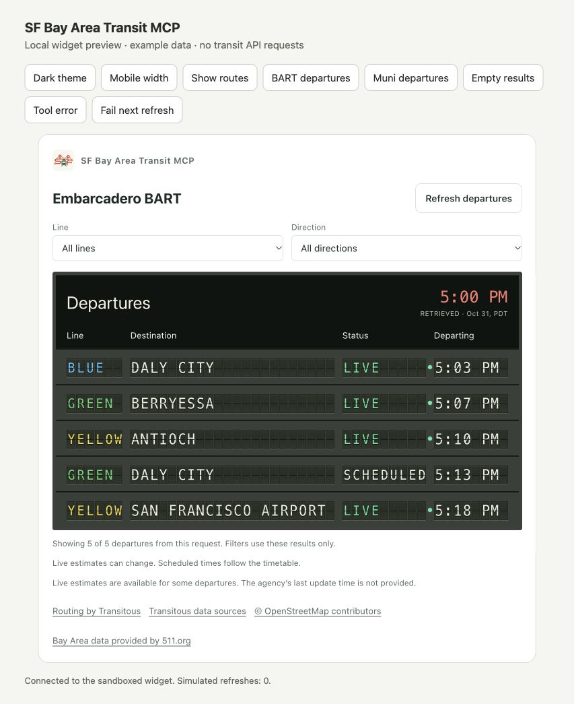
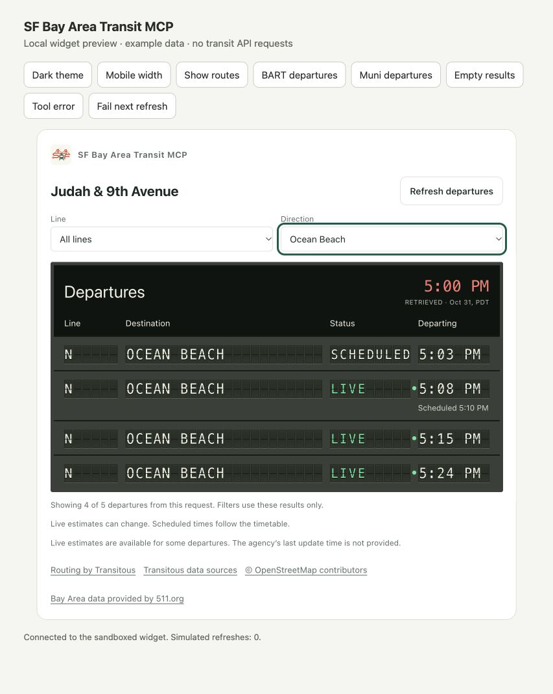
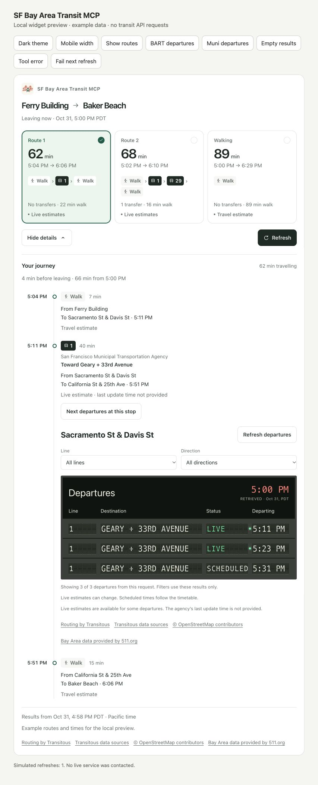

# Departure-board design previews

These offline prototypes use a Ferry Building-style matrix display. Times are examples, not current transit predictions. They do not change the hosted MCP or contact transit services. They are retained as visual design history. The implemented `get_stop_departures` tool and interactive boards are documented in the [main README](../../README.md#next-departures).

Run from the repository:

```sh
node scripts/preview-arrivals.mjs
```

Open [the local preview](http://127.0.0.1:8801/). The toolbar switches between BART, Muni, trip details, and light/dark themes.

For the implemented interactive view with fictional examples, run `npm run preview:widget` and open [http://127.0.0.1:8798/](http://127.0.0.1:8798/). The screenshots below come from that view; they use example data.

## Product behavior explored

- Use one `get_stop_departures` tool on the existing MCP endpoint. A new HTTP endpoint is not needed.
- Use a standalone board for questions such as “What departs next from Embarcadero BART?” Resolve ambiguous stops with the existing place-search tool.
- In trip details, offer **Next departures at this stop** beside the selected boarding step. Opening it would request that stop's board through the same tool.
- Keep the trip plan and departure board separate. Refreshing the board should not silently change the selected journey.
- Show live estimates and scheduled times per departure. The Muni prototype intentionally includes an early departure with no live estimate.
- Label the time of retrieval accurately. Do not present it as the agency's last prediction update.
- Load on request or Refresh; no continuous polling.

## Design choices

- Use shorter character blocks in the matrix display to keep each departure compact and destinations readable.
- Color BART line names to identify each service, without a colored stripe. Keep the line name readable as text.
- Show live departure times in green, with a pulsing green dot next to the time and a **LIVE** label.
- Show scheduled departure times as regular white text on the dark board, without a dot, and label them **SCHEDULED**.
- Label the retrieval time **Retrieved**. It records when the board was fetched, not when the agency last updated its predictions.
- Respect reduced-motion preferences by stopping the pulse.

The display uses HTML text and CSS. No agency logos or remote fonts are used.

## Screens

1. `/?view=bart&theme=light`: Embarcadero BART, direction filters and mixed prediction status.
2. `/?view=muni&theme=light`: Muni N, route/direction filters and scheduled-versus-live distinctions.
3. `/?view=trip&theme=light`: existing trip cards with a departure board opened at the selected stop.

[](../../docs/arrival-previews/bart-departures.jpg)

[](../../docs/arrival-previews/muni-departures.jpg)

[](../../docs/arrival-previews/trip-with-departures.jpg)

See the [live-arrivals research](../../docs/live-arrivals-research.md) for data-source findings.

Controls simulate their behavior with fixtures. The historical prototype is separate from the implemented MCP integration. Its controls are not evidence of live provider results.
